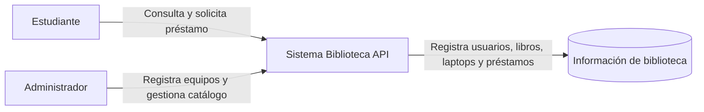
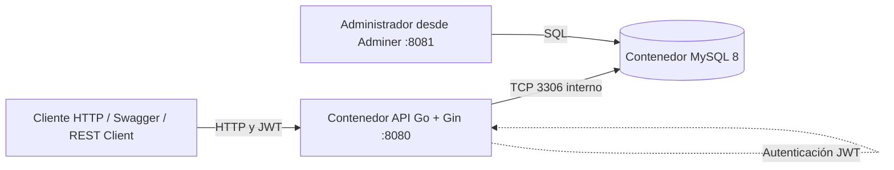
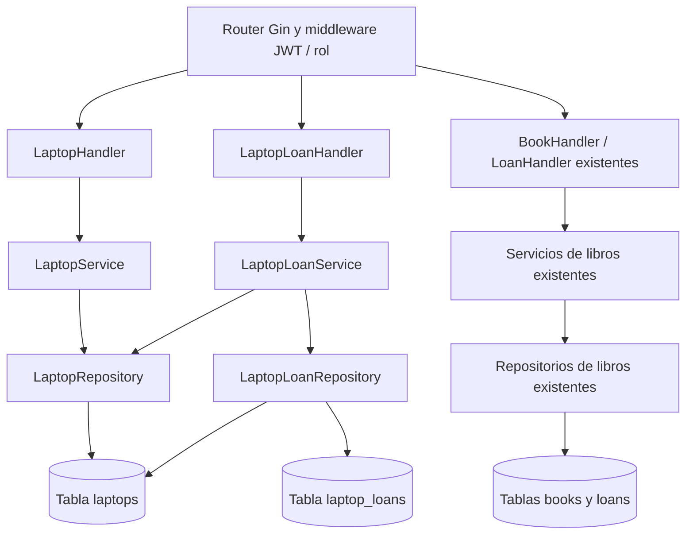
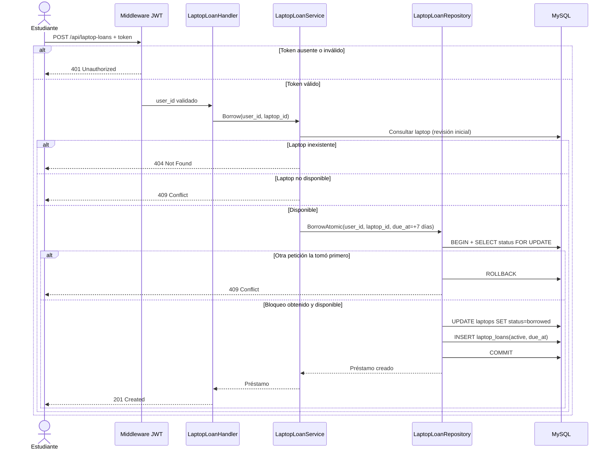
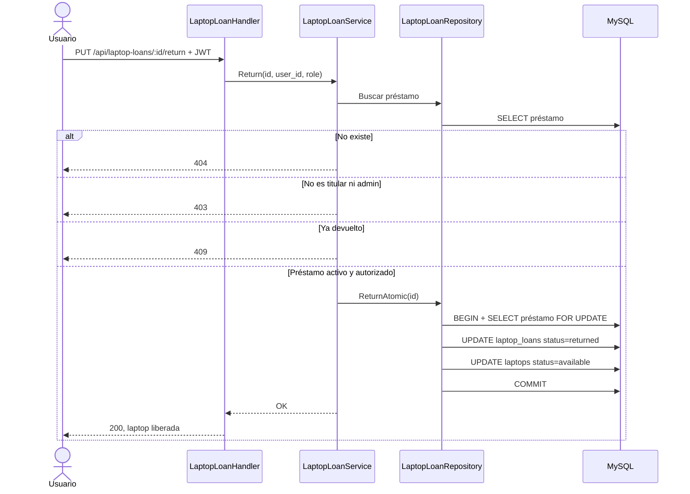

# Fase 5 — Diagramas de arquitectura (Mermaid)

**Integrantes:**
- Christian Javier Benitez Castro — T00082581
- Sean Paul Martinez Roa — T00083011  
Decisión ADR-001: módulo de laptops paralelo, misma autenticación y misma base de datos física.

## 1. C4 Nivel 1 — Contexto

**Pregunta:** ¿Quién usa el sistema y con qué objetivo?

## 2. C4 Nivel 2 — Contenedores

**Pregunta:** ¿Qué ejecutables se comunican? El cliente es el navegador/REST Client del estudiante; no se afirma que exista un frontend React desplegado.

## 3. Componentes internos de la API

**Pregunta:** ¿Dónde vive la lógica de laptops sin afectar la de libros?

## 4. Diagrama de secuencia — Prestar laptop

**Pregunta:** ¿Cuándo se valida y cómo se evita prestarla dos veces?

## 5. Secuencia complementaria — Devolver y liberar inventario

## 6. Coherencia con la implementación

- `models/laptop.go`: estructuras de inventario, request y préstamo.
- `repository/laptop_loan_repository.go`: transacción, bloqueo y SQL.
- `service/laptop_service.go`: duración, estado y autorización de devolución.
- `handler/laptop_handler.go`: validación HTTP y códigos de respuesta.
- `handler/routes.go`: JWT, rutas protegidas y ruta admin.
- `migrations/002_laptops.sql`: tablas `laptops` y `laptop_loans`.

Los diagramas son propuesta de arquitectura del código adjunto y deben contrastarse con el fork efectivamente publicado.
